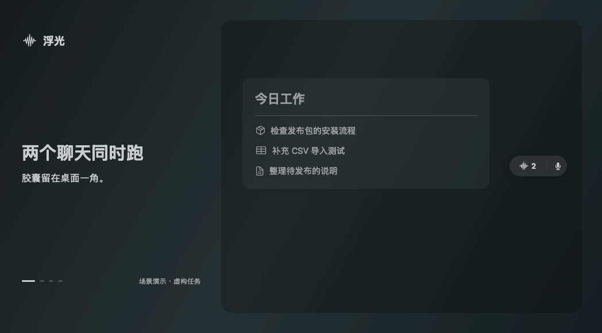

# 浮光 · Fuguang

在 Mac 上跟进并行的 Codex 桌面聊天。保留完成提醒，点击聊天标题直接回到结果。

[查看浅色和深色静态预览](fuguang-preview.png)

当几个聊天同时运行时，浮光把未读结果放在最前面。胶囊会亮起，但不会弹出窗口。打开面板后流光熄灭，结果仍留在列表，直到你打开对应聊天或展开详情。

- 点击标题打开原聊天，点击右侧「···」查看该聊天记录中的模型、访问和用量。
- 可以按标题或工作目录找聊天，范围包含折叠的历史聊天。只有一个可跳转的搜索结果时，按回车即可打开。
- 基础任务监控读取当前 Mac 上的 Codex 日志和聊天标题索引，无需安装 Hook。数据在本机处理。

当前是 Apple 芯片 Mac 的开发测试版。需要兼容的 Codex 桌面版本和本机任务日志。正式签名和公证待完成。模型和默认权限的切换、原生审批接管仍待接通。

如果你经常在 Mac 上并行使用 Codex 桌面聊天，欢迎到 Issues 新建「试用反馈」。只看过演示也可以反馈最近一次漏看结果或反复切窗口的经历。提交前请删除项目名称、目录、聊天内容和账号信息。

---

Follow parallel Codex desktop chats on your Mac. Open the capsule to see unread results, then click a title to return to its chat. Float uses local Codex records for basic monitoring. This is a development preview for Apple silicon Macs. [Light and dark preview](fuguang-preview.png).
